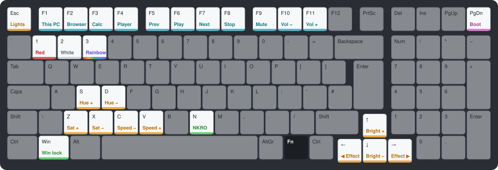

# GMMK V2 96 ISO keymap

Custom QMK keymap (`acooke`) for the Glorious GMMK V2 96% ISO. Every push builds the firmware; download the latest `.bin` from [Releases](../../releases/tag/latest).

Hold **Fn** (right of AltGr) for everything coloured below. While Fn is held, the keyboard lights the same map: unused keys go dark and toggles show their state.



## Fn shortcuts

### Lighting

| Keys | Does |
|---|---|
| Fn + 1 / 2 / 3 | Preset: all red / all white / rainbow (Cycle Left/Right). Keeps brightness. |
| Fn + Esc | Lights on / off |
| Fn + ← / → | Previous / next effect |
| Fn + ↑ / ↓ | Brighter / dimmer |
| Fn + S / D | Hue up / down |
| Fn + Z / X | Saturation up / down |
| Fn + C / V | Effect slower / faster |

### Media and apps

| Keys | Does |
|---|---|
| Fn + F1–F4 | This PC, browser home, calculator, media player |
| Fn + F5 / F6 / F7 | Previous track / play-pause / next track |
| Fn + F8 | Stop |
| Fn + F9 | Mute |
| Fn + F10 / F11 | Volume down / up |

### System

| Keys | Does |
|---|---|
| Fn + Win | Windows-key lock, for games |
| Fn + N | NKRO on / off (saved across reboots) |
| Fn + PgDn | Bootloader, for flashing firmware |

## What the lights mean while Fn is held

| Colour | Meaning |
|---|---|
| Your current effect | Lighting controls, so changes show as you make them |
| Red / white / rainbow | The three presets on 1, 2, 3 |
| Cyan | Media and app keys |
| Green | NKRO is on, or the Windows key works |
| Red (solid) | NKRO is off |
| Red (blinking) | Windows key is locked |
| Magenta | Bootloader |
| White | The Fn key, and anything else added to the Fn layer in VIA |

Nothing is drawn over the lighting unless Fn is held. With the lights off there is nothing to colour.

## Notes

- Three layers: base, Fn and an empty layer 2. Five do not fit in the keyboard's 1 KB of settings storage. Put `MO(2)` on a spare key in VIA to use layer 2.
- Flashing a new build resets VIA changes, so save the layout in VIA first.
- To reach the bootloader without the keymap: hold Esc while plugging in (also resets settings), or hold the reset pin under the spacebar.
- In VIA the preset keys show as custom keycodes `0x7E40`–`0x7E42`.
- Symbol legends in the diagram are UK ISO; the OS keyboard language decides what they type.

---

## About this repo (QMK Userspace)

This is a template repository which allows for an external set of QMK keymaps to be defined and compiled. This is useful for users who want to maintain their own keymaps without having to fork the [main QMK repository](https://github.com/qmk/qmk_firmware). You must still fork the main QMK repository if writing firmware for a *new* keyboard.

## Howto configure your build targets

1. Run the normal `qmk setup` procedure if you haven't already done so -- see [QMK Docs](https://docs.qmk.fm/#/newbs) for details.
1. Fork this repository
1. Clone your fork to your local machine
1. Enable userspace in QMK config using `qmk config user.overlay_dir="$(realpath qmk_userspace)"`
1. Add a new keymap for your board using `qmk new-keymap`
    * This will create a new keymap in the `keyboards` directory, in the same location that would normally be used in the main QMK repository. For example, if you wanted to add a keymap for the Planck, it will be created in `keyboards/planck/keymaps/<your keymap name>`
    * You can also create a new keymap using `qmk new-keymap -kb <your_keyboard> -km <your_keymap>`
    * Alternatively, add your keymap manually by placing it in the location specified above.
    * `layouts/<layout name>/<your keymap name>/keymap.*` is also supported if you prefer the layout system
1. Add your keymap(s) to the build by running `qmk userspace-add -kb <your_keyboard> -km <your_keymap>`
    * This will automatically update your `qmk.json` file
    * Corresponding `qmk userspace-remove -kb <your_keyboard> -km <your_keymap>` will delete it
    * Listing the build targets can be done with `qmk userspace-list`
1. Commit your changes

## Howto build with GitHub

1. In the GitHub Actions tab, enable workflows
1. Push your changes above to your forked GitHub repository
1. Look at the GitHub Actions for a new actions run
1. Wait for the actions run to complete
1. Inspect the Releases tab on your repository for the latest firmware build

## Howto build locally

1. Run the normal `qmk setup` procedure if you haven't already done so -- see [QMK Docs](https://docs.qmk.fm/#/newbs) for details.
1. Fork this repository
1. Clone your fork to your local machine
1. `cd` into this repository's clone directory
1. Set global userspace path: `qmk config user.overlay_dir="$(realpath .)"` -- you MUST be located in the cloned userspace location for this to work correctly
    * This will be automatically detected if you've `cd`ed into your userspace repository, but the above makes your userspace available regardless of your shell location.
1. Compile normally: `qmk compile -kb your_keyboard -km your_keymap` or `make your_keyboard:your_keymap`

Alternatively, if you configured your build targets above, you can use `qmk userspace-compile` to build all of your userspace targets at once.

## Extra info

If you wish to point GitHub actions to a different repository, a different branch, or even a different keymap name, you can modify `.github/workflows/build_binaries.yml` to suit your needs.

To override the `build` job, you can change the following parameters to use a different QMK repository or branch:
```
    with:
      qmk_repo: qmk/qmk_firmware
      qmk_ref: master
```

If you wish to manually manage `qmk_firmware` using git within the userspace repository, you can add `qmk_firmware` as a submodule in the userspace directory instead. GitHub Actions will automatically use the submodule at the pinned revision if it exists, otherwise it will use the default latest revision of `qmk_firmware` from the main repository.

This can also be used to control which fork is used, though only upstream `qmk_firmware` will have support for external userspace until other manufacturers update their forks.

1. (First time only) `git submodule add https://github.com/qmk/qmk_firmware.git`
1. (To update) `git submodule update --init --recursive`
1. Commit your changes to your userspace repository
